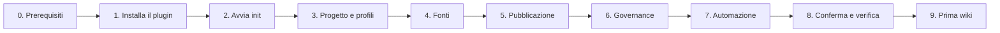

## 🧙 Wizard di configurazione

Percorso guidato, un passo alla volta, per configurare la wiki di un progetto. Per ogni passo trovi **cosa ti chiede il wizard**, **come scegliere** e **come verificare** di aver fatto bene. Per l'uso quotidiano passa poi alla [guida utente](guida-utente.md).

> [!TIP]
> Non devi conoscere i file di configurazione: scrivi `init` all'agente **LLM Wiki** e rispondi alle domande. Questa pagina spiega cosa rispondere e perché.
>
> Preferisci seguirlo un passo alla volta, spuntando le verifiche? Usa la [versione web interattiva](https://raythekool.github.io/power-platform-llm-wiki/wizard.html).



### ⏱️ Prima di iniziare: le tre risposte che ti servono

Raccogli queste informazioni prima di aprire il wizard: lo renderanno veloce.

| Domanda                                                   | Esempio                                           |
| --------------------------------------------------------- | ------------------------------------------------- |
| Come si chiama il progetto e che tecnologia usa?          | "Vendite", Dynamics 365 CE + Finance & Operations |
| Dove si trova il codice (e dove vuoi pubblicare la wiki)? | Azure Repos, GitHub o una cartella sul PC         |
| Chi certifica i contenuti lato cliente?                   | Un key user con nome e cognome                    |

---

### 🧰 Passo 0 - Prerequisiti

Servono sempre **VS Code con GitHub Copilot**, **PowerShell 7** e **git**. Il resto dipende dalle fonti che userai.

| Se userai…                             | Ti serve               | Come controllare                   |
| -------------------------------------- | ---------------------- | ---------------------------------- |
| Qualsiasi fonte                        | PowerShell 7           | `pwsh --version`                   |
| Codice o pubblicazione                 | git                    | `git --version`                    |
| Azure Repos o Azure DevOps Wiki        | Git Credential Manager | `git credential-manager --version` |
| Dataverse                              | `pacx` (o `pac`)       | `pacx --version`                   |
| GitHub (attività o GitHub Wiki)        | GitHub CLI             | `gh auth status`                   |
| Documenti Word, PowerPoint, Excel, PDF | `markitdown`           | `markitdown --version`             |

✅ **Verifica:** i comandi che ti servono rispondono con un numero di versione. Se `pwsh` manca, **fermati**: senza PowerShell 7 la wiki non funziona.

> [!NOTE]
> L'agente non installa nulla da solo: ti segnala cosa manca e ti lascia decidere.

---

### 📦 Passo 1 - Installa il plugin

1. In VS Code apri **Impostazioni** e attiva **Chat > Plugins: Enabled**.
2. In **Chat > Plugins: Marketplaces** aggiungi `raythekool/power-platform-llm-wiki`.
3. Nella vista **Extensions** cerca `@agentPlugins power-platform-llm-wiki` e installa.

Se lavori dal terminale invece che da VS Code:

```shell
# GitHub Copilot CLI
copilot plugin marketplace add raythekool/power-platform-llm-wiki
copilot plugin install power-platform-llm-wiki@power-platform-llm-wiki

# Claude Code
claude plugin marketplace add raythekool/power-platform-llm-wiki
claude plugin install power-platform-llm-wiki@power-platform-llm-wiki
```

In Claude Code le skill si chiamano `/power-platform-llm-wiki:init`, `:update` e così via.

✅ **Verifica:** nella chat, nell'elenco degli agenti compare **LLM Wiki**.

---

### 🚪 Passo 2 - Avvia `init`

1. Apri in VS Code la cartella del **repository del progetto**, quello che ospiterà la cartella `llm-wiki/`.
2. Nella chat scegli l'agente **LLM Wiki**.
3. Scrivi `init`.

Il wizard ti chiede subito la modalità:

| Scelta             | Quando sceglierla                                                                                |
| ------------------ | ------------------------------------------------------------------------------------------------ |
| 🧭 **Guidato**      | Prima volta, o non conosci i file di configurazione (consigliato)                                |
| 📝 **Self-service** | Sai già cosa vuoi: crea un file `wiki.config.yml` commentato, lo compili tu e poi lanci `config` |

Il resto di questa pagina segue la modalità guidata.

---

### 🏷️ Passo 3 - Progetto e profili

**Il wizard chiede:** nome del progetto, lingua dei contenuti, profili.

- **Nome**: compare nell'intestazione della wiki pubblicata. Esempio: `Vendite`.
- **Lingua**: `it` per contenuti in italiano (predefinito), `en` per inglese.
- **Profili** (puoi sceglierne più di uno):

| Profilo          | Scegli se il progetto…                                                        |
| ---------------- | ----------------------------------------------------------------------------- |
| `power-platform` | usa Dynamics 365 CE / Dataverse: plugin, PCF, web resource, flow, soluzioni   |
| `dynamics-fno`   | usa Finance & Operations: tabelle, estensioni, classi, data entity, sicurezza |
| `generic`        | è fatto di integrazioni, Azure Functions, API, .NET                           |

✅ **Verifica:** i profili scelti corrispondono a ciò che c'è davvero nel codice. In caso di dubbio scegli quelli che ti servono ora: li cambi più avanti con `config`.

---

### 🔌 Passo 4 - Fonti

Tutte le fonti sono **facoltative**. Il wizard le propone una per volta: rispondi **Sì** solo a quelle che hai.

| Fonte                      | Cosa ti chiede                                                                   | Note                                                                         |
| -------------------------- | -------------------------------------------------------------------------------- | ---------------------------------------------------------------------------- |
| 🧬 **Repository di codice** | nome, provider (`azure-devops`, `github`, `local`), URL, cartella locale, branch | **Consigliata**: il codice è la fonte primaria della documentazione as-built |
| 📋 **Azure DevOps Boards**  | organizzazione, progetto, aree e iterazioni (facoltative)                        | Accesso con il tuo account Microsoft: **non serve nessun PAT**               |
| 🗄️ **Dataverse**            | nomi univoci delle soluzioni, prefissi del publisher                             | Usa il profilo `pacx auth` attivo: controlla con `pacx auth ping`            |
| 🏭 **Metadati F&O**         | cartelle dei package **personalizzati** (es. `<repo>/Metadata/<Package>`)        | Non indicare i package standard Microsoft                                    |
| 🐙 **Attività GitHub**      | elenco `owner/repo`                                                              | Pull request, issue, branch                                                  |
| 📂 **SharePoint**           | URL del sito e librerie                                                          | I documenti vanno scaricati in `raw/` a mano                                 |

**Esempio per un progetto CE su Azure DevOps**

- Repository di codice: nome `crm-solution`, provider `azure-devops`, branch `develop`, cartella locale `../crm-solution`.
- Boards: organizzazione `contoso`, progetto `Vendite`.
- Dataverse: soluzione `VenditeCore`, prefisso `cts_`.

> [!IMPORTANT]
> Non scrivere mai password, token o chiavi nelle risposte o nel file di configurazione. L'accesso avviene con il tuo account (Microsoft Entra ID, `az login`, `pacx auth`).

✅ **Verifica:** per ogni repository la cartella locale esiste (o verrà clonata). Per Dataverse, `pacx auth ping` risponde.

---

### 🌐 Passo 5 - Pubblicazione

**Il wizard chiede:** dove pubblicare la wiki.

| Scelta                            | Quando                                              | Cosa ti chiede                      |
| --------------------------------- | --------------------------------------------------- | ----------------------------------- |
| 🔷 **Azure DevOps - project wiki** | La wiki del progetto Azure DevOps (caso più comune) | organizzazione, progetto, nome wiki |
| 🔷 **Azure DevOps - code wiki**    | La wiki è una cartella di un repository             | repository, branch, cartella        |
| 🐙 **GitHub Wiki**                 | Il progetto vive su GitHub                          | `owner/repo`                        |
| ⏭️ **Nessuna**                     | Per ora consulti la wiki solo in VS Code            | -                                   |

Facoltativo: una **pagina madre** (esempio `Knowledge Base`) sotto cui montare tutta la wiki.

> [!NOTE]
> La pubblicazione automatica senza conferma è **disattivata** per impostazione predefinita: prima di ogni push vedrai le modifiche e dovrai confermare.

✅ **Verifica:** hai a portata di mano i dati per accedere alla wiki di destinazione (permessi di scrittura inclusi). Puoi anche scegliere "Nessuna" e configurarla più tardi.

---

### 🛡️ Passo 6 - Governance

**Il wizard chiede:**

| Domanda                                    | Valore consigliato | Significato                                                             |
| ------------------------------------------ | ------------------ | ----------------------------------------------------------------------- |
| Redigere i dati personali?                 | **Sì**             | Dei partecipanti restano solo nomi e ruoli                              |
| Dopo quanti giorni una pagina è "vecchia"? | `30`               | Il lint segnala le pagine non aggiornate oltre questa soglia            |
| Chi certifica le pagine?                   | nomi e cognomi     | Facoltativo; serve a sapere chi può dichiarare una pagina "certificata" |

✅ **Verifica:** hai almeno un nome per la certificazione, tipicamente un key user o un referente del cliente. Il processo completo è in [governance.md](governance.md).

---

### 🤖 Passo 7 - Automazione (solo repository su GitHub)

Il wizard te lo chiede **solo** se il repository ospite è su GitHub.

| Scelta   | Effetto                                                         |
| -------- | --------------------------------------------------------------- |
| `weekly` | Aggiornamento settimanale automatico (consigliato per iniziare) |
| `daily`  | Aggiornamento ogni giorno                                       |
| `manual` | Nessuna automazione: aggiorni tu con `update --full`            |

Se scegli una pianificazione, l'agente ti dà il testo da incollare in **Repository → Agents → Automations → Create new → On a schedule**. Se il repository è su Azure DevOps, salta questo passo e lancia `update --full` da VS Code quando serve.

**Sprint** (solo con Azure DevOps Boards): durata (predefinita 2 settimane) e formato del nome (`YYYY-SNN`).

---

### ✅ Passo 8 - Conferma e verifica

1. Il wizard mostra un **riepilogo** della configurazione e l'elenco dei file che crea o modifica. Controllalo con calma.
2. Rispondi **Sì** per procedere, **No** per annullare senza scrivere nulla.

Al termine il progetto contiene:

| Cosa                              | A cosa serve                                           |
| --------------------------------- | ------------------------------------------------------ |
| `llm-wiki/wiki.config.yml`        | Le tue scelte (puoi modificarlo a mano o con `config`) |
| `llm-wiki/raw/`                   | Dove metti FDD, TDD, verbali e altri documenti         |
| `llm-wiki/wiki/`                  | La wiki vera e propria (pagine Markdown)               |
| `llm-wiki/.engine/` e `AGENTS.md` | Il motore gestito dal plugin: **non modificarli**      |
| `.vscode/mcp.json`                | Il collegamento ad Azure DevOps, se usi le Boards      |
| `.github/copilot-instructions.md` | Le istruzioni che fanno usare la wiki a Copilot        |

✅ **Verifica finale** (la fa l'agente, ma puoi ripeterla):

```powershell
pwsh llm-wiki/.engine/scripts/Test-WikiLint.ps1 -WikiPath llm-wiki/wiki
```

Il risultato deve indicare **0 errori**. Poi fai commit dei file creati.

---

### 🚀 Passo 9 - Costruisci la prima wiki

Scegli in base alle fonti che hai attivato:

| Se hai attivato…       | Scrivi all'agente                                                                                    |
| ---------------------- | ---------------------------------------------------------------------------------------------------- |
| 🧬 Codice               | `update --source code`                                                                               |
| 🗄️ Dataverse            | `update --source dataverse`                                                                          |
| 🏭 F&O                  | `update --source fno`                                                                                |
| 📋 Boards               | `update --source devops`                                                                             |
| 📄 Documenti già pronti | copia i file in `llm-wiki/raw/analysis/`, `specs/` o `meetings/`, poi `ingest raw/<cartella>/<file>` |

Quando hai finito:

1. `update --lint` controlla la qualità (deve restare a 0 errori).
2. `query "come è fatto il modulo vendite?"` prova una domanda sulla wiki.
3. `update --publish` pubblica, se hai configurato la pubblicazione.

---

### 🔁 Cambiare idea più tardi

Non devi rifare `init`. Scrivi `config` e scegli cosa cambiare: aggiungere o togliere fonti, profili, lingua, pubblicazione, governance, automazione. Dopo un aggiornamento del plugin lancia `config --refresh-engine`, poi `update --lint`.

### 🩺 Se qualcosa non funziona

| Sintomo                                                   | Cosa fare                                                                                                                            |
| --------------------------------------------------------- | ------------------------------------------------------------------------------------------------------------------------------------ |
| L'agente **LLM Wiki** non compare                         | Controlla **Chat > Plugins: Enabled** e che il plugin sia installato; riavvia VS Code                                                |
| `pwsh` non trovato                                        | Installa PowerShell 7 e riapri VS Code                                                                                               |
| Il clone di Azure Repos chiede le credenziali di continuo | Installa Git Credential Manager e accedi con il tuo account                                                                          |
| Dataverse non risponde                                    | Esegui `pacx auth list` e `pacx auth ping`; seleziona il profilo giusto con `pacx auth select`                                       |
| Le Boards non restituiscono dati                          | Controlla organizzazione e progetto con `config` e verifica di avere accesso al progetto                                             |
| Il lint segnala errori dopo `init`                        | Leggi l'elenco degli errori (o il report `llm-wiki/wiki/lint-*.md` generato da `update --lint`), correggi e rilancia `update --lint` |
| Vuoi ripartire da zero                                    | Rilancia `init`: non sovrascrive le pagine né i documenti già presenti in `raw/`                                                     |

> [!TIP]
> Altre risposte nelle [domande frequenti](guida-utente.md#-domande-frequenti).
