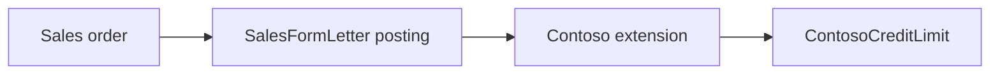

# F&O credit extensions

> Custom credit limit table and the Chain of Command extension that blocks sales posting above the limit.

## Components

- `AxTable:ContosoCreditLimit` stores the limit per customer and relates to `AxTable:CustTable`.
- `AxClass:SalesFormLetter_Contoso_Extension` extends `SalesFormLetter` with Chain of Command (calls `next`).
- The data entity `ContosoCreditLimitEntity` exposes the limits; the Dataverse side reads `dv:salesorder`.
- Delivered in sprint `2026-S08` with `US-128`.

> ⚠️ **Drift:** [REQ-SAL-001](../requirements/REQ-SAL-001-credit-check.md) blocks confirmation, the code blocks posting (`contoso@C1234:Metadata/ContosoExt/ContosoExt/AxClass/SalesFormLetter_Contoso_Extension.xml`).

